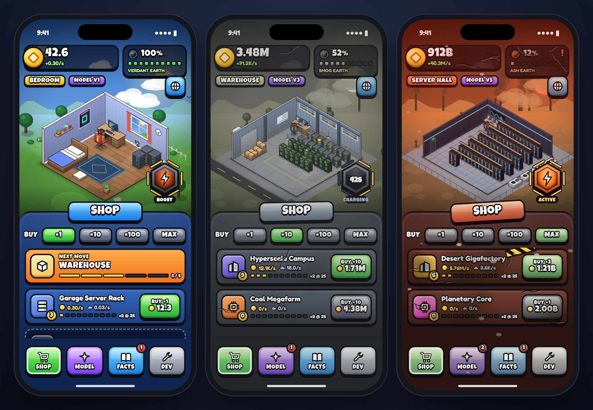

# iPhone idle games

This repo has two SwiftUI apps. Open either `.swiftpm` folder in Xcode and press ⌘R.

- **`Overclock.swiftpm`**: the AI data center idle game from the design doc (first playable).
- **`SporeGarden.swiftpm`**: the simple idle game template it grew from.

## Overclock

Grow an AI company from one server rack to a planet-wide compute empire while the Earth goes from green to smog to ash.



**The look.** An arcade / simulator-game style: glossy buttons with thick black outlines, white text with a heavy stroke, clean SHOP panel with soft gradients, coin counter, big square menu buttons with red badges, and a hexagon BOOST chip with charge segments. Fonts: Luckiest Guy and Fredoka (bundled in `Fonts/`, free licences included).

**Everything decays with the planet.**
- The UI fades from bright blue to grey to rust red. Grime, cracks and hazard tape appear, the SHOP sign tilts, and in the last phase ash falls over the screen with a red alarm glow.
- Your building stands on real ground under a real sky: blue sky, green lawn and leafy trees at first, then grey smog with smokestacks on the horizon, then an orange sky over cracked dirt and dead trees.
- The globe (🌍 button, or the final stage) is a realistic Earth built from Natural Earth coastlines (public domain). It has day and night, city lights, clouds, polar ice and an atmosphere glow. As Health falls, deserts spread, ice melts, coastal seas dry into seabed, haze thickens and wildfires appear.

**Fold the shop away** to watch your world: tap the SHOP sign, swipe the panel down, or tap the menu button you're on. Tap any menu button (or swipe up) to bring it back.

**Your base grows with you**, drawn in isometric 2.5D. You start as one guy with a server in his bedroom. At 5 servers you move to a Warehouse, then a Server Hall (first Office Data Center), a riverside Campus (first Hyperscale Campus), and a Horizon Megacenter rising over the planet's curve (first Coal-Powered Megafarm). The Planetary Compute Core turns the whole globe into the data center. Every move gets a "Moving day!" banner.

**Gameplay** (from the design doc):
- 8 building tiers with the doc's costs, outputs and pollution. A tier unlocks at 10 of the one before; tiers 5–6 arrive in Smog, 7–8 in Ash.
- Earth Health = 100 · e^(−pollution / K), with K growing each phase. Smog at 66% (income ×3), Ash at 33% (income ×5, heatwaves), and "The last river runs dry" at 0%.
- Tap the world for tokens. BOOST: ×2 income and ×3 pollution for 10 s, then a 60 s cooldown.
- Power choice per building (Coal / Gas / Solar-Nuclear) from Smog phase on.
- Milestones (×2 output at 25, 50, 100…), bulk buy ×1/×10/×100/MAX.
- Train a New Model (prestige) for Parameters (+2% income each), plus 5 upgrades in the AI Lab, including an auto-scaler.
- 14 sourced fact cards from the doc, collected in the FACTS tab.
- Offline earnings at 50%, capped at 4 h (up to 12 h); pollution keeps building up while you're away.
- DEV tab: skip time, add tokens, damage the Earth, 10×/100× speed, grant Parameters, test offline.

Not built yet: Metal fluid simulation, tilt with CoreMotion, coolant routing, phase cinematics, audio, Restoration, widgets, ads/IAP and iCloud.

All the numbers are in `Overclock.swiftpm/Config.swift`. The K values were tuned with a simulated player: Smog at about 24 minutes and Ash after about 13 hours of play in the first run. Playtest and adjust.

# Spore Garden: idle game template for iPhone

A small, complete idle/clicker game in SwiftUI, set up so you can change it and play right away.

It includes:

- A tap button with haptics and floating "+N" numbers
- 7 generators with rising costs, plus Buy ×1 / ×10 / ×100 / Max
- Milestones: owning 25, 50, 100… of a generator doubles its output
- One-time upgrades that unlock as you progress
- Prestige: reset your run to earn permanent bonus points
- Offline earnings, with a "Welcome back" popup
- Autosave every 5 seconds and whenever the app goes to the background
- A **Dev** tab with time skips, free currency, 10×/100× speed and a save reset

## Run it on your Mac

1. Install **Xcode** from the Mac App Store (free). Open it once so it can install its components, including the iOS Simulator.
2. Get this repository onto your Mac (GitHub Desktop, or `git clone` in Terminal).
3. Double-click the **`SporeGarden.swiftpm`** folder. It opens in Xcode as an app project. (Or use File → Open in Xcode and pick that folder.)
4. At the top of the Xcode window, choose a simulator such as **iPhone 16**.
5. Press **⌘R** (or click ▶). The iPhone Simulator opens and the game starts.

You click with the mouse to tap. Use ⌘← and ⌘→ to rotate, and ⇧⌘H to go to the home screen. That last one is a quick way to test offline earnings: leave the app for 30 seconds or more, then come back.

### On your real iPhone (optional)

Plug your iPhone in. In Xcode, select it instead of a simulator. You may need to sign in with your Apple ID under Xcode → Settings → Accounts and pick your team under the app's Signing settings. A free Apple ID works for testing on your own phone. The app expires after 7 days and you re-run it from Xcode.

You can also open `SporeGarden.swiftpm` in the **Swift Playgrounds** app on a Mac or iPad.

## Where to play around

| You want to… | Edit |
|---|---|
| Rename the game, currency or emoji | `GameConfig.swift`, at the top |
| Make things cheaper, pricier or faster | `GameConfig.swift`: `baseCost`, `costGrowth`, `baseRate` |
| Add a generator | `GameConfig.swift`: add a `GeneratorDef(...)` line to `generators` |
| Add an upgrade | `GameConfig.swift`: add an `UpgradeDef(...)` to `upgrades` |
| Change prestige | `GameConfig.swift`: `prestige` |
| Change the rules (how multipliers stack, offline pay) | `GameModel.swift` |
| Change colors and layout | `ContentView.swift` (colors are in `Theme` at the top) |

After each change press **⌘R** again.

**Live preview:** in `ContentView.swift`, open the canvas with ⌥⌘↩ to see your view update as you type. To get a preview, add this at the bottom of the file:

```swift
#Preview {
    ContentView().environmentObject(GameModel())
}
```

**Start a fresh save:** use Dev → Reset save, or change `saveKey` in `GameConfig.swift`.

### Ideas to try next

- Balance: change `costGrowth` from `1.15` to `1.07` and see how fast the game snowballs.
- Add achievements to `GameModel`, such as "own 10 of every generator".
- Add a random golden mushroom that appears on screen for a few seconds and gives 60 seconds of income when tapped.
- Add sound with `AVAudioPlayer`.
- Before releasing: set `debug = false`, change `bundleIdentifier` in `Package.swift`, and add a real app icon.

## Files

```
SporeGarden.swiftpm/
├── Package.swift        App settings: name, bundle ID, icon, iOS version
├── GameConfig.swift     All the tunable numbers and content
├── GameModel.swift      Game rules, game loop, saving, offline earnings
├── ContentView.swift    All the screens
└── SporeGardenApp.swift App entry point
```
